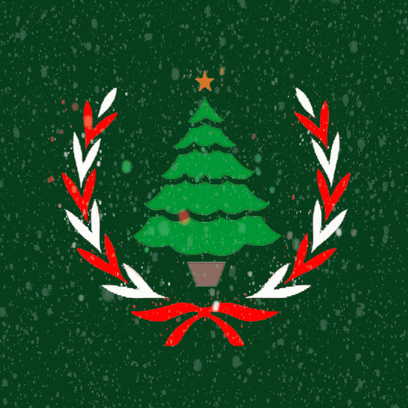
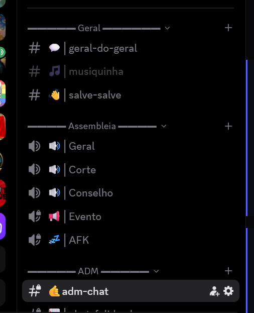

# OFurryBot 🐾 — Sistema de Temas & Base Oficial da ONU

**OFurryBot** é o bot e gerenciador de temas sazonais da **Organização das Nações Unidas (ONU)** no Discord (`561721456405381123`).

O sistema foi desenhado de forma **híbrida** (`Markdown + JSON + Assets`): cada época do ano possui sua própria pasta em [`themes/`](./themes) com documentação visual (`README.md`), logos oficiais do servidor (`assets/icon.png` e `assets/icon.gif`) e configuração automatizada (`theme.json`).

---

## 🖼️ Galeria de Logos Oficiais dos Temas

| 🌐 Base Oficial (ONU) | 🌐 Base Animada (GIF) | 🎃 Halloween | 🎄 Natal (Animado) | 🐰 Páscoa |
| :---: | :---: | :---: | :---: | :---: |
|  |  |  |  |  |
| [`icon.png`](./themes/base-onu/assets/icon.png) | [`icon.gif`](./themes/base-onu/assets/icon.gif) | [`icon.png`](./themes/halloween/assets/icon.png) | [`icon.gif`](./themes/natal/assets/icon.gif) · [`icon.png`](./themes/natal/assets/icon.png) | [`icon.png`](./themes/pascoa/assets/icon.png) |

---

## 🗂️ 1. Catálogo de Temas (`themes/`)

| Tema | Pasta / Docs | Config JSON | Nome do Servidor | Moldura de Categoria | Sep. Canal | Sep. Cargo |
| :--- | :--- | :--- | :--- | :--- | :---: | :---: |
| 🌐 **Base Oficial (ONU)** | [`themes/base-onu/README.md`](./themes/base-onu/README.md) | [`theme.json`](./themes/base-onu/theme.json) | `Organização das Nações Unidas` | `▬▬▬▬▬▬  Nome  ▬▬▬▬▬▬` | `│` | `-----------------` |
| 🎃 **Halloween** | [`themes/halloween/README.md`](./themes/halloween/README.md) | [`theme.json`](./themes/halloween/theme.json) | `Organização das Nações Assombradas 🎃` | `╭─── 🎃 Nome 🎃 ───╮` | `┃` | `─── 🦇 ───` |
| 🎄 **Natal** | [`themes/natal/README.md`](./themes/natal/README.md) | [`theme.json`](./themes/natal/theme.json) | `Organização das Nações Natalinas 🎄` | `❄️ ═══ Nome ═══ ❄️` | `┇` | `═══ ❄️ ═══` |
| 🎆 **Ano Novo** | [`themes/ano-novo/README.md`](./themes/ano-novo/README.md) | [`theme.json`](./themes/ano-novo/theme.json) | `Organização das Nações Renovadas 🎆` | `✨ ━━━ Nome ━━━ ✨` | `╏` | `━━━ ✨ ━━━` |
| 🐰 **Páscoa** | [`themes/pascoa/README.md`](./themes/pascoa/README.md) | [`theme.json`](./themes/pascoa/theme.json) | `Organização das Nações da Páscoa 🐰` | `🌸 ─── Nome ─── 🌸` | `┆` | `─── 🥚 ───` |

> [!TIP]
> O mapeamento bruto completo de segurança (com todos os **48 cargos**, **permissões bitmask**, **54 emojis** e dados do servidor secundário) está salvo em:
> 📄 **[`docs/full-server-mapping.md`](./docs/full-server-mapping.md)**

---

## 🔄 2. Matriz Comparativa de Canais por Tema (IDs Fixos)

Todos os temas mapeiam exatamente os **mesmos 14 canais/categorias** através de seus IDs fixos no Discord:

| Tipo | ID Fixo | 🌐 Base ONU | 🎃 Halloween | 🎄 Natal | 🎆 Ano Novo | 🐰 Páscoa |
| :---: | :--- | :--- | :--- | :--- | :--- | :--- |
| 📁 | `794044198881198090` | `▬▬▬▬▬▬  Geral  ▬▬▬▬▬▬` | `╭─── 🎃 Cripta Geral 🎃 ───╮` | `❄️ ═══ Vila do Noel ═══ ❄️` | `✨ ━━━ Réveillon Geral ━━━ ✨` | `🌸 ─── Grande Conselho da Páscoa ─── 🌸` |
| `#` | `794044202803658752` | `🌍│geral-do-geral` | `🕸️┃geral-do-além` | `🎄┇ceia-geral` | `🥂╏brinde-geral` | `🌍┆chat-geral-da-paz` |
| `#` | `794044204488720415` | `🎵│musiquinha` | `🎻┃sinfonia-macabra` | `🔔┇jingle-bells` | `🎶╏playlist-da-virada` | `🎵┆sinfonia-da-páscoa` |
| `#` | `794044207596568628` | `👋│salve-salve` | `🪦┃novas-almas` | `🎁┇cartinhas-pro-noel` | `🎇╏novos-ciclos` | `👋┆boas-vindas-da-renovação` |
| 📁 | `794044199514406923` | `▬▬▬▬▬ Assembleia  ▬▬▬▬▬` | `╭── 💀 Seita Suprema 💀 ──╮` | `🎄 ═══ Polo Norte ═══ 🎄` | `🎆 ━━━ Cúpula da Virada ━━━ 🎆` | `🥚 ─── Plenário de Primavera ─── 🥚` |
| `🔊` | `794044207231926302` | `🛰️│Central de Voz` | `🕯️┃Câmara das Sombras` | `🛷┇Trenó Central` | `🎆╏Praia de Copacabana` | `🗳️┆Plenário da Primavera` |
| `🔊` | `794044205231112232` | `🏛️│Supremo Tribunal` | `⚰️┃Tribunal da Inquisição` | `📜┇Lista dos Bons e Maus` | `⚖️╏Retrospectiva do Ano` | `⚖️┆Tribunal do Coelho` |
| `🔊` | `794044203771363328` | `🎙️│Palanque Central` | `🔮┃Altar do Ritual` | `⭐┇Chaminé Central` | `⏳╏Contagem Regressiva` | `🕊️┆Mesa Redonda dos Ovos` |
| `🔊🔒` | `812400426108452865` | `🎉│Salão da Festa` | `🎃┃Baile dos Vampiros` | `🍗┇Ceia de Natal` | `🍾╏After da Virada` | `🎉┆Salão de Festa dos Ovos` |
| `🔊🔒` | `794044208855777322` | `💤│AFK` | `🧟┃Cemitério AFK` | `⛄┇Boneco Congelado AFK` | `🥴╏Ressaca AFK` | `💤┆Túmulo dos Inativos da Páscoa` |
| 📁🔒 | `794044200756051989` | `▬▬▬▬▬ ADM ▬▬▬▬▬` | `╭─── 🩸 Submundo ADM 🩸 ───╮` | `🦌 ═══ Oficina ADM ═══ 🦌` | `🥂 ━━━ Camarote ADM ━━━ 🥂` | `🍫 ─── Alto Comando do Cacau ─── 🍫` |
| `#🔒` | `794044213368848396` | `🤙adm-chat` | `🩸┃pacto-adm` | `🎅┇conselho-do-noel` | `🍾╏vip-adm` | `🔒┆arquivos-secretos-do-conselho` |
| `#🔒` | `794044205848723468` | `📉│chat-falido-de-memes` | `👻┃memes-amaldiçoados` | `🧦┇meia-de-memes` | `📉╏retrospectiva-de-memes` | `📉┆memes-chocos` |
| `🔊🔒` | `794044216933089320` | `Call Dos Ademar` | `🦇┃Covil dos Ademar` | `🦌┇Estábulo dos Ademar` | `🥂╏Camarote dos Ademar` | `👑┆Cúpula dos Coelhos Supremos` |

---

## 🛡️ 3. Matriz Comparativa da Hierarquia Principal de Cargos

Apenas os **4 cargos da Hierarquia Principal** e os **4 separadores visuais** mudam a cada evento (todos os outros ~30 cargos customizados/zoeira permanecem intocados):

| Escalão | Role ID | 🌐 Base ONU | 🎃 Halloween | 🎄 Natal | 🎆 Ano Novo | 🐰 Páscoa |
| :--- | :--- | :--- | :--- | :--- | :--- | :--- |
| **Tier 1 (Pos 38)** | `794044179029819392` | `Secretariado` (`#5B92E5`) | `🎃 Lordes das Sombras` (`#FF6B00`) | `🎅 Conselho do Bom Velhinho` (`#D62828`) | `🎆 Soberanos do Novo Ciclo` (`#FFD700`) | `🍫 Alto Comando do Cacau` (`#A0522D`) |
| **Tier 2 (Pos 29)** | `845826535810269225` | `Corte Jurídica` (`#F1C40F`) | `💀 Inquisidores Supremos` (`#9B59B6`) | `⭐ Guardiões da Estrela Guia` (`#F7B801`) | `🥂 Guardiões do Tempo` (`#F4A261`) | `⚖️ Tribunal do Coelho` (`#FFD166`) |
| **Tier 3 (Pos 5)** | `794044189042147340` | `Corpo Diplomático` (`#95A5A6`) | `🧛 Emissários Noturnos` (`#C0392B`) | `🦌 Embaixadores do Polo Norte` (`#2A9D8F`) | `✨ Embaixadores da Virada` (`#90E0EF`) | `🕊️ Embaixadores da Primavera` (`#FF85A1`) |
| **Tier 4 (Pos 4)** | `794044191951945778` | `Assembleia Geral` (`#1ABC9C`) | `👻 Almas da Assembleia` (`#2ECC71`) | `🧝 Duendes da Assembleia` (`#52B788`) | `🎇 Cidadãos do Novo Ano` (`#E0FBFC`) | `🥚 Plenário da Páscoa` (`#80ED99`) |
| **Separadores (x4)** | `900181759507968031` etc. | `-----------------` | `─── 🦇 ───` | `═══ ❄️ ═══` | `━━━ ✨ ━━━` | `─── 🥚 ───` |

---

## 📸 4. Prints de Referência do Servidor

<p align="left">
  
  
</p>

---

## 🚀 5. Como Aplicar um Tema (Modo Híbrido)

### Opção A: Pedindo direto para a IA (Via Discord MCP)
Basta pedir no chat do Antigravity:
> *"Aplica o tema `halloween` no servidor da ONU usando o MCP"*
> *"Restaura o servidor para a `base-onu`"*

### Opção B: Via Script CLI (`Bun`)
1. Configure seu `.env` a partir do [`.env.example`](./.env.example).
2. Liste os temas disponíveis:
   ```bash
   bun run theme:list
   ```
3. Simule um tema sem alterar nada no Discord (`--dry-run`):
   ```bash
   bun run theme:dry pascoa
   ```
4. Aplique o tema em produção (altera nome do servidor, logo, categorias, canais e cargos):
   ```bash
   bun run theme pascoa
   # Ou para voltar ao padrão:
   bun run theme base-onu
   ```

---

## 🔌 6. Configuração do Servidor MCP (`mcp_config.json`)

```json
{
  "mcpServers": {
    "discord-mcp": {
      "command": "java",
      "args": [
        "-jar",
        "C:\\Users\\jcami\\.gemini\\antigravity-cli\\bin\\discord-mcp-1.0.0.jar"
      ],
      "env": {
        "DISCORD_TOKEN": "SEU_DISCORD_BOT_TOKEN_AQUI",
        "DISCORD_GUILD_ID": "561721456405381123"
      }
    }
  }
}
```
