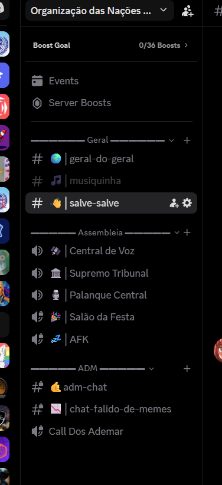

# Mapeamento Bruto Completo — Servidores ONU (Referência de Segurança)

Este documento preserva **100% dos dados brutos originais** extraídos via Discord MCP dos dois servidores em `2026-10-20`, incluindo todos os **48 cargos** (inclusive os cargos customizados/zoeira e bots que não são alterados pelos temas), **sobrescritas de permissão (bitmasks)** e **54 emojis customizados**.

---

## 🌐 1. Informações Gerais dos Servidores

| Propriedade | Servidor Principal (Base Oficial) | Servidor Secundário (Laboratório/Backup) |
| :--- | :--- | :--- |
| **Nome** | `Organização das Nações Unidas` | `ONU` |
| **Guild ID** | `561721456405381123` | `790382141254795274` |
| **Owner** | `jcamilo12` | `jcamilo12` |
| **Criado em** | `2019-03-31` | `2020-12-21` |
| **Membros** | `102` | `8` |
| **Ícone (Hash)** | `dba50749a2e628a739d751d8fed9fb9a` | `4d5deb6f20e8724882a0da28db88f116` |
| **URL do Ícone** | [CDN Link](https://cdn.discordapp.com/icons/561721456405381123/dba50749a2e628a739d751d8fed9fb9a.png?size=1024) | [CDN Link](https://cdn.discordapp.com/icons/790382141254795274/4d5deb6f20e8724882a0da28db88f116.png?size=1024) |
| **Estrutura** | 3 Categorias · 5 Texto · 6 Voz · 48 Cargos · 54 Emojis | 3 Categorias · 8 Texto · 5 Voz · 20 Cargos · 1 Emoji |

---

## 🔐 2. Mapeamento de Permissões (Overwrites por Canal/Categoria — `561721456405381123`)

| Canal / Categoria | Cargo (Role) | Allow (Permitido) | Deny (Negado) |
| :--- | :--- | :--- | :--- |
| **📁 `▬▬▬▬▬▬  Geral  ▬▬▬▬▬▬`** (`794044198881198090`) | `@everyone` | `View Channels`, `Create Instant Invite`, `Send Messages`, `Manage Messages`, `Read History` (`6755399441132545`) | — |
| | `Orion Mute` | — | `Add Reactions`, `Send Messages`, `Connect`, `Speak` (`3147840`) |
| **`# 🌍│geral-do-geral`** (`794044202803658752`) | `@everyone` | `View Channels`, `Create Instant Invite`, `Send Messages`, `Manage Messages`, `Read History` (`6755399441132545`) | — |
| | `Orion Mute` | — | `Add Reactions`, `Send Messages`, `Connect`, `Speak` (`3147840`) |
| **`# 🎵│musiquinha`** (`794044204488720415`) | `@everyone` | `View Channels`, `Create Instant Invite`, `Send Messages`, `Manage Messages` (`6755399441067009`) | — |
| | `Orion Mute` | — | `Add Reactions`, `Send Messages`, `Connect`, `Speak` (`3147840`) |
| **`# 👋│salve-salve`** (`794044207596568628`) | `@everyone` | `View Channels`, `Read History` (`66560`) | `Send Messages`, `Send TTS Messages` (`6144`) |
| | `Corpo Diplomático` | `View Channels`, `Connect` (`1049600`) | — |
| | `Assembleia Geral` | `View Channels`, `Connect` (`1049600`) | — |
| | `Orion Mute` | — | `Add Reactions`, `Send Messages`, `Connect`, `Speak` (`3147840`) |
| **📁 `▬▬▬▬▬ Assembleia  ▬▬▬▬▬`** (`794044199514406923`) | `@everyone` | `View Channels`, `Video`, `Connect` (`1050112`) | — |
| | `Assembleia Geral` | `View Channels`, `Connect` (`1049600`) | — |
| | `Orion Mute` | — | `Add Reactions`, `Send Messages`, `Connect`, `Speak` (`3147840`) |
| **`🔊 🛰️│Central de Voz`** (`794044207231926302`) | `@everyone` | `View Channels`, `Video`, `Connect` (`1050112`) | — |
| | `Assembleia Geral` | `View Channels`, `Video`, `Connect`, `Speak` (`3147264`) | — |
| | `Orion Mute` | — | `Add Reactions`, `Send Messages`, `Connect`, `Speak` (`3147840`) |
| **`🔊 🏛️│Supremo Tribunal`** (`794044205231112232`) | `@everyone` | `View Channels`, `Video`, `Connect` (`1050112`) | — |
| | `Assembleia Geral` | `View Channels`, `Connect` (`1049600`) | — |
| | `Orion Mute` | — | `Add Reactions`, `Send Messages`, `Connect`, `Speak` (`3147840`) |
| **`🔊 🎙️│Palanque Central`** (`794044203771363328`) | `@everyone` | `View Channels`, `Video`, `Connect` (`1050112`) | — |
| | `Assembleia Geral` | `View Channels`, `Connect` (`1049600`) | — |
| | `Orion Mute` | — | `Add Reactions`, `Send Messages`, `Connect`, `Speak` (`3147840`) |
| **`🔊🔒 🎉│Salão da Festa`** (`812400426108452865`) | `@everyone` | `Video` (`512`) | `Connect` (`1048576`) |
| | `Orion Mute` | — | `Add Reactions`, `Send Messages`, `Connect`, `Speak` (`3147840`) |
| **`🔊🔒 💤│AFK`** (`794044208855777322`) | `@everyone` | — | `Priority Speaker`, `Speak`, `Use Voice Activity` (`35651840`) |
| | `Secretariado` | — | `Speak` (`2097152`) |
| | `Orion Mute` | — | `Add Reactions`, `Send Messages`, `Connect`, `Speak` (`3147840`) |
| **📁 `▬▬▬▬▬ ADM ▬▬▬▬▬`** (`794044200756051989`) | `@everyone` | — | `View Channels`, `Connect` (`1049600`) |
| | `Secretariado` | `View Channels`, `Connect` (`1049600`) | — |
| | `Orion Mute` | — | `Add Reactions`, `Send Messages`, `Connect`, `Speak` (`3147840`) |
| **`#🔒 🤙adm-chat`** (`794044213368848396`) | `@everyone` | — | `View Channels`, `Connect` (`1049600`) |
| | `Secretariado` | `View Channels`, `Connect` (`1049600`) | — |
| | `Corte Jurídica` | `View Channels`, `Connect` (`1049600`) | — |
| | `Orion Mute` | — | `Add Reactions`, `Send Messages`, `Connect`, `Speak` (`3147840`) |
| **`#🔒 📉│chat-falido-de-memes`** (`794044205848723468`) | `@everyone` | — | `View Channels`, `Connect` (`1049600`) |
| | `Secretariado` | `View Channels`, `Connect` (`1049600`) | — |
| | `Orion Mute` | — | `Add Reactions`, `Send Messages`, `Connect`, `Speak` (`3147840`) |
| **`🔊🔒 Call Dos Ademar`** (`794044216933089320`) | `@everyone` | — | `View Channels`, `Connect` (`1049600`) |
| | `Secretariado` | `View Channels`, `Connect` (`1049600`) | — |
| | `Corte Jurídica` | `View Channels`, `Connect` (`1049600`) | — |
| | `Orion Mute` | — | `Add Reactions`, `Send Messages`, `Connect`, `Speak` (`3147840`) |

---

## 🛡️ 3. Todos os 48 Cargos (Roles) em Ordem Hierárquica (`561721456405381123`)

| Pos | Nome do Cargo | Role ID | Cor Hex (Original) | RGB | Hoisted | Mentionable | Permissions (Bitmask) | Escopo nos Temas |
| :-: | :--- | :--- | :---: | :---: | :---: | :---: | :--- | :--- |
| `46` | `ADM` | `900181942983622736` | `None` | `536870911` | ❌ | ❌ | `4294967304` | Fixo (Admin) |
| `45` | `-----------------` | `900181759507968031` | `None` | `536870911` | ❌ | ❌ | `1071627896832` | **Tematizável (Separador 1)** |
| `44` | `Xenon` | `738439202269823108` | `None` | `536870911` | ❌ | ❌ | `8` | Fixo (Bot) |
| `43` | `Orion Mute` | `866735906849161227` | `None` | `536870911` | ❌ | ❌ | `0` | Fixo (Mute) |
| `42` | `Loritta` | `561725393451745300` | `None` | `536870911` | ❌ | ❌ | `4512397800767679` | Fixo (Bot) |
| `41` | `Dyno` | `880610908957736971` | `None` | `536870911` | ❌ | ❌ | `1513962695871` | Fixo (Bot) |
| `40` | `Oficiais` | `767772911112028181` | `None` | `536870911` | ❌ | ❌ | `8` | Fixo (Admin) |
| `39` | `-----------------` | `845826404380835841` | `None` | `536870911` | ❌ | ❌ | `0` | **Tematizável (Separador 2)** |
| `38` | `Secretariado` | `794044179029819392` | `None` (`#5B92E5` na Base) | `536870911` | ✅ | ❌ | `6782320278765307` | **Tematizável (Hierarquia 1)** |
| `37` | `ADM` | `957720003594059776` | `#E67E22` | `15105570` | ❌ | ❌ | `1071627897856` | Fixo |
| `36` | `Mandrake` | `794044182020096020` | `#E74C3C` | `15158332` | ❌ | ❌ | `0` | Intocado (Customizado) |
| `35` | `Crente` | `818916995252092938` | `#E91E63` | `15277667` | ❌ | ❌ | `0` | Intocado (Customizado) |
| `34` | `Top 3 no kart da empresa 🤙🤙` | `819241064950267944` | `#19859C` | `1672604` | ❌ | ✅ | `0` | Intocado (Customizado) |
| `33` | `Fanboy de Gintama` | `854369905418567701` | `#E67E22` | `15105570` | ❌ | ❌ | `109555222528` | Intocado (Customizado) |
| `32` | `Ragebaiter` | `1459964959701078275` | `#79D7FD` | `7985149` | ❌ | ❌ | `0` | Intocado (Customizado) |
| `31` | `Gostosin` | `794044180635582465` | `#010000` | `65536` | ❌ | ❌ | `0` | Intocado (Customizado) |
| `30` | `-----------------` | `854712377982976010` | `None` | `536870911` | ❌ | ❌ | `109555222528` | **Tematizável (Separador 3)** |
| `29` | `Corte Jurídica` | `845826535810269225` | `None` (`#F1C40F` na Base) | `536870911` | ✅ | ❌ | `6783918023376593` | **Tematizável (Hierarquia 2)** |
| `28` | `Garoto de Programa de Luxo` | `1239683781686857748` | `#E91E63` | `15277667` | ❌ | ❌ | `0` | Intocado (Customizado) |
| `27` | `Colono exadada` | `906512032382214144` | `#206694` | `2123412` | ❌ | ❌ | `1071627896832` | Intocado (Customizado) |
| `26` | `Amém` | `870463624823570524` | `#FFFCFC` | `16776444` | ✅ | ❌ | `246994176000` | Intocado (Customizado) |
| `25` | `General` | `877706340833820692` | `#9DDD99` | `10345881` | ❌ | ❌ | `521872082944` | Intocado (Customizado) |
| `24` | `Sábio` | `877705549540626472` | `#9B59B6` | `10181046` | ❌ | ❌ | `521872082944` | Intocado (Customizado) |
| `23` | `Batedor de Carteado` | `794044180351549461` | `#1ABC9C` | `1752220` | ❌ | ❌ | `0` | Intocado (Customizado) |
| `22` | `Comedor De Casadas` | `904810944427868200` | `#E91E63` | `15277667` | ❌ | ❌ | `1071627896832` | Intocado (Customizado) |
| `21` | `2D` | `794044186952466474` | `#206694` | `2123412` | ❌ | ❌ | `0` | Intocado (Customizado) |
| `20` | `DEUS VITÃO` | `794044187430748161` | `#C7B133` | `13087027` | ❌ | ❌ | `0` | Intocado (Customizado) |
| `19` | `PT` | `904710864756690954` | `#FC0303` | `16515843` | ❌ | ❌ | `1071627896832` | Intocado (Customizado) |
| `18` | `Senpai` | `966725547621228604` | `#408F5A` | `4231002` | ❌ | ❌ | `1071627896832` | Intocado (Customizado) |
| `17` | `Rato Aquático` | `966725537198407750` | `#BC2E25` | `12332581` | ❌ | ❌ | `1071627896832` | Intocado (Customizado) |
| `16` | `As Gurias` | `1044043802324766842` | `#DF2493` | `14623891` | ❌ | ❌ | `1071627896832` | Intocado (Customizado) |
| `15` | `Ta pegando Fogo Bixo` | `1436851818436231198` | `#FF0000` | `16711680` | ❌ | ❌ | `0` | Intocado (Customizado) |
| `14` | `LoiraGostosa` | `1507929418423734344` | `#F1C40F` | `15844367` | ❌ | ❌ | `0` | Intocado (Customizado) |
| `13` | `Jogador de Gayshit🤮🤮🤮🤡🤡` | `1357499683601125548` | `None` | `536870911` | ✅ | ✅ | `0` | Intocado (Customizado) |
| `12` | `Pri Player` | `995790354634788935` | `#C56767` | `12937063` | ❌ | ❌ | `1071627896832` | Intocado (Customizado) |
| `11` | `Jogador de Ark💩💩💩` | `1357499106691514388` | `#2ECC71` | `3066993` | ❌ | ❌ | `0` | Intocado (Customizado) |
| `10` | `Allahu Akbar` | `1201957347740893234` | `#F1C40F` | `15844367` | ❌ | ❌ | `0` | Intocado (Customizado) |
| `9` | `éOStagi` | `1532936652257755256` | `#0A0505` | `656645` | ❌ | ❌ | `0` | Intocado (Customizado) |
| `8` | `Gorodo` | `1485390103390978201` | `#9B59B6` | `10181046` | ❌ | ❌ | `0` | Intocado (Customizado) |
| `7` | `Server Booster` | `786554804963901462` | `#F353CA` | `15946698` | ❌ | ❌ | `0` | Fixo (Sistema) |
| `6` | `-----------------` | `794044188408283217` | `None` | `536870911` | ❌ | ❌ | `0` | **Tematizável (Separador 4)** |
| `5` | `Corpo Diplomático` | `794044189042147340` | `#95A5A6` | `9807270` | ✅ | ❌ | `8941840223809` | **Tematizável (Hierarquia 3)** |
| `4` | `Assembleia Geral` | `794044191951945778` | `#1ABC9C` | `1752220` | ✅ | ❌ | `6546640449` | **Tematizável (Hierarquia 4)** |
| `3` | `Hydra` | `1043677923854532630` | `None` | `536870911` | ❌ | ❌ | `6755399478144344` | Fixo (Bot) |
| `2` | `Euphony` | `1480025901079986241` | `None` | `536870911` | ❌ | ❌ | `20204552` | Fixo (Bot) |
| `1` | `Jockie Music` | `1480026205230072009` | `None` | `536870911` | ❌ | ❌ | `8` | Fixo (Bot) |
| `0` | `FurryBOT` | `1562260850071314506` | `None` | `536870911` | ❌ | ❌ | `8` | Fixo (`OFurryBot`) |
| `-1` | `@everyone` | `561721456405381123` | `None` | `536870911` | ❌ | ❌ | `2222085116004352` | Fixo |

---

## 😀 4. Todos os 54 Emojis Customizados (`561721456405381123`)

| Nome | Emoji ID | Animado | Sintaxe Discord | URL Direta (CDN) |
| :--- | :--- | :---: | :--- | :--- |
| `JCcarioca` | `569335951088680980` | ❌ | `<:JCcarioca:569335951088680980>` | [PNG](https://cdn.discordapp.com/emojis/569335951088680980.png) |
| `COMUNISMO` | `655812796692561920` | ❌ | `<:COMUNISMO:655812796692561920>` | [PNG](https://cdn.discordapp.com/emojis/655812796692561920.png) |
| `BECKDORMINDO` | `655814470043697367` | ❌ | `<:BECKDORMINDO:655814470043697367>` | [PNG](https://cdn.discordapp.com/emojis/655814470043697367.png) |
| `SAD` | `655814891914919936` | ❌ | `<:SAD:655814891914919936>` | [PNG](https://cdn.discordapp.com/emojis/655814891914919936.png) |
| `XISUM` | `655815331834626058` | ❌ | `<:XISUM:655815331834626058>` | [PNG](https://cdn.discordapp.com/emojis/655815331834626058.png) |
| `OOF` | `655816697927827457` | ❌ | `<:OOF:655816697927827457>` | [PNG](https://cdn.discordapp.com/emojis/655816697927827457.png) |
| `MONOYASUOHIGHELO` | `658109323691556884` | ❌ | `<:MONOYASUOHIGHELO:658109323691556884>` | [PNG](https://cdn.discordapp.com/emojis/658109323691556884.png) |
| `JCDISNEY` | `672857900984827915` | ❌ | `<:JCDISNEY:672857900984827915>` | [PNG](https://cdn.discordapp.com/emojis/672857900984827915.png) |
| `acheiiz` | `681897232672227375` | ❌ | `<:acheiiz:681897232672227375>` | [PNG](https://cdn.discordapp.com/emojis/681897232672227375.png) |
| `beckcomendo` | `691753369391333406` | ❌ | `<:beckcomendo:691753369391333406>` | [PNG](https://cdn.discordapp.com/emojis/691753369391333406.png) |
| `BECKOFEDIDO` | `692959999219204116` | ❌ | `<:BECKOFEDIDO:692959999219204116>` | [PNG](https://cdn.discordapp.com/emojis/692959999219204116.png) |
| `pornodojc` | `692963040534200340` | ❌ | `<:pornodojc:692963040534200340>` | [PNG](https://cdn.discordapp.com/emojis/692963040534200340.png) |
| `cowboydobeck` | `692963438795685898` | ❌ | `<:cowboydobeck:692963438795685898>` | [PNG](https://cdn.discordapp.com/emojis/692963438795685898.png) |
| `JCSOCORRO` | `693281209693765726` | ❌ | `<:JCSOCORRO:693281209693765726>` | [PNG](https://cdn.discordapp.com/emojis/693281209693765726.png) |
| `FBI` | `697632120712986776` | ❌ | `<:FBI:697632120712986776>` | [PNG](https://cdn.discordapp.com/emojis/697632120712986776.png) |
| `BOTEI` | `697632370446041179` | ❌ | `<:BOTEI:697632370446041179>` | [PNG](https://cdn.discordapp.com/emojis/697632370446041179.png) |
| `yareyaredaze` | `697633570302459974` | ❌ | `<:yareyaredaze:697633570302459974>` | [PNG](https://cdn.discordapp.com/emojis/697633570302459974.png) |
| `sansrindo` | `697634367983452160` | ❌ | `<:sansrindo:697634367983452160>` | [PNG](https://cdn.discordapp.com/emojis/697634367983452160.png) |
| `KONODIODA` | `697635133200793650` | ❌ | `<:KONODIODA:697635133200793650>` | [PNG](https://cdn.discordapp.com/emojis/697635133200793650.png) |
| `bota` | `697636218292404324` | ❌ | `<:bota:697636218292404324>` | [PNG](https://cdn.discordapp.com/emojis/697636218292404324.png) |
| `EUTOTILTADOCARA` | `697637688035246110` | ❌ | `<:EUTOTILTADOCARA:697637688035246110>` | [PNG](https://cdn.discordapp.com/emojis/697637688035246110.png) |
| `HMM` | `697638976298942494` | ❌ | `<:HMM:697638976298942494>` | [PNG](https://cdn.discordapp.com/emojis/697638976298942494.png) |
| `dorime` | `697653519397945344` | ❌ | `<:dorime:697653519397945344>` | [PNG](https://cdn.discordapp.com/emojis/697653519397945344.png) |
| `Dolime` | `697658065268244609` | ❌ | `<:Dolime:697658065268244609>` | [PNG](https://cdn.discordapp.com/emojis/697658065268244609.png) |
| `OCRIME` | `699363254115237900` | ❌ | `<:OCRIME:699363254115237900>` | [PNG](https://cdn.discordapp.com/emojis/699363254115237900.png) |
| `MorteAosFurri` | `714322184314814544` | ❌ | `<:MorteAosFurri:714322184314814544>` | [PNG](https://cdn.discordapp.com/emojis/714322184314814544.png) |
| `LULUJOSE` | `720755948775407669` | ❌ | `<:LULUJOSE:720755948775407669>` | [PNG](https://cdn.discordapp.com/emojis/720755948775407669.png) |
| `skate` | `726276997998837760` | ❌ | `<:skate:726276997998837760>` | [PNG](https://cdn.discordapp.com/emojis/726276997998837760.png) |
| `Aaerodinmicadeumavaca` | `726278011921629254` | ❌ | `<:Aaerodinmicadeumavaca:726278011921629254>` | [PNG](https://cdn.discordapp.com/emojis/726278011921629254.png) |
| `obrad` | `734910073599557764` | ❌ | `<:obrad:734910073599557764>` | [PNG](https://cdn.discordapp.com/emojis/734910073599557764.png) |
| `fuedase` | `757011995802206299` | ❌ | `<:fuedase:757011995802206299>` | [PNG](https://cdn.discordapp.com/emojis/757011995802206299.png) |
| `claudio` | `757018786753675325` | ❌ | `<:claudio:757018786753675325>` | [PNG](https://cdn.discordapp.com/emojis/757018786753675325.png) |
| `ERNESTO` | `761073612190384169` | ❌ | `<:ERNESTO:761073612190384169>` | [PNG](https://cdn.discordapp.com/emojis/761073612190384169.png) |
| `cu` | `763025885665689600` | ❌ | `<:cu:763025885665689600>` | [PNG](https://cdn.discordapp.com/emojis/763025885665689600.png) |
| `PequenoDarlinho` | `772136985150226503` | ❌ | `<:PequenoDarlinho:772136985150226503>` | [PNG](https://cdn.discordapp.com/emojis/772136985150226503.png) |
| `BongoAsol` | `788546543099445268` | ✅ | `<a:BongoAsol:788546543099445268>` | [GIF](https://cdn.discordapp.com/emojis/788546543099445268.gif) |
| `Evandro` | `792623814294241281` | ❌ | `<:Evandro:792623814294241281>` | [PNG](https://cdn.discordapp.com/emojis/792623814294241281.png) |
| `ban2` | `794444019547504651` | ✅ | `<a:ban2:794444019547504651>` | [GIF](https://cdn.discordapp.com/emojis/794444019547504651.gif) |
| `emoji2` | `794632957914513429` | ✅ | `<a:emoji2:794632957914513429>` | [GIF](https://cdn.discordapp.com/emojis/794632957914513429.gif) |
| `emoji3` | `794633064679735306` | ✅ | `<a:emoji3:794633064679735306>` | [GIF](https://cdn.discordapp.com/emojis/794633064679735306.gif) |
| `fidgetspinner` | `794633177145540639` | ✅ | `<a:fidgetspinner:794633177145540639>` | [GIF](https://cdn.discordapp.com/emojis/794633177145540639.gif) |
| `Pvzl14` | `794633265230512159` | ✅ | `<a:Pvzl14:794633265230512159>` | [GIF](https://cdn.discordapp.com/emojis/794633265230512159.gif) |
| `Pvzl50` | `794633335425990677` | ✅ | `<a:Pvzl50:794633335425990677>` | [GIF](https://cdn.discordapp.com/emojis/794633335425990677.gif) |
| `Pvzl12` | `794633384436564048` | ✅ | `<a:Pvzl12:794633384436564048>` | [GIF](https://cdn.discordapp.com/emojis/794633384436564048.gif) |
| `Pvzl23` | `794633508743675912` | ✅ | `<a:Pvzl23:794633508743675912>` | [GIF](https://cdn.discordapp.com/emojis/794633508743675912.gif) |
| `Pvzl51` | `794633533346807853` | ✅ | `<a:Pvzl51:794633533346807853>` | [GIF](https://cdn.discordapp.com/emojis/794633533346807853.gif) |
| `ahegao` | `805997754731331624` | ❌ | `<:ahegao:805997754731331624>` | [PNG](https://cdn.discordapp.com/emojis/805997754731331624.png) |
| `davi` | `811727107277062215` | ❌ | `<:davi:811727107277062215>` | [PNG](https://cdn.discordapp.com/emojis/811727107277062215.png) |
| `miss` | `820047013374722068` | ❌ | `<:miss:820047013374722068>` | [PNG](https://cdn.discordapp.com/emojis/820047013374722068.png) |
| `JaMetiaRola` | `827163962234634270` | ❌ | `<:JaMetiaRola:827163962234634270>` | [PNG](https://cdn.discordapp.com/emojis/827163962234634270.png) |
| `JaMetiaRola20` | `827169372782198794` | ❌ | `<:JaMetiaRola20:827169372782198794>` | [PNG](https://cdn.discordapp.com/emojis/827169372782198794.png) |
| `EMPANADAS` | `839646578612240414` | ❌ | `<:EMPANADAS:839646578612240414>` | [PNG](https://cdn.discordapp.com/emojis/839646578612240414.png) |
| `FLAMENGO` | `973686265536987176` | ❌ | `<:FLAMENGO:973686265536987176>` | [PNG](https://cdn.discordapp.com/emojis/973686265536987176.png) |
| `cat` | `1449244377774817362` | ❌ | `<:cat:1449244377774817362>` | [PNG](https://cdn.discordapp.com/emojis/1449244377774817362.png) |

---

## 🏛️ 5. Mapeamento do Servidor Secundário (`ONU` — ID: `790382141254795274`)

### Canais Atuais no Servidor Secundário
- **📁 `╭────── Geral ───────╮`** (`791071510731292682`)
  - `# geral-do-geral` (`791071460487331840`)
  - `# cartas` (`791071610538295296`)
  - `# menes-tipos-de-carinhas-são` (`791071735884677161`)
  - `# doces-ou-travessuras` (`791071905817165875`)
  - `# eventos` (`1484969768942440639`)
  - `# eventos-pascoa` (`1487228811530731590`)
- **📁 `▬▬▬▬ Assembleia  ▬▬▬▬`** (`791072033152565258`)
  - `🔊 Geral` (`791074075980070934`)
  - `🔊 Conselho Economico` (`791072492034588753`)
  - `🔊 Conselho De Segurança` (`791073055220301834`)
  - `🔊 Limpando Teias De Aranha` (`791072294838730752`)
  - `🔊 Festinha` (`791072406734897183`)
- **📁 `backup onu antiga`** (`792506029710508043`)
  - `# backup` (`792506430279778314`)
  - `# ai-generate` (`1088065722829246525`)

### Cargos Atuais no Servidor Secundário (`790382141254795274`)
| Pos | Nome | Role ID | Cor Hex | Hoisted | Permissions |
| :-: | :--- | :--- | :---: | :---: | :--- |
| `18` | `<3` | `791065399767990293` | `None` | ✅ | `6442450952` |
| `17` | `Representantes` | `791065400388616213` | `None` | ✅ | `6442450952` |
| `16` | `Dos Anão` | `791065393660690524` | `#F1C40F` | ❌ | `6442450944` |
| `15` | `Dos Loli` | `791065395553370142` | `#CC561E` | ❌ | `6442450944` |
| `14` | `Dos Gordin` | `791065394784895059` | `#010000` | ❌ | `6442450944` |
| `13` | `-------------------------` | `791065398594371594` | `None` | ❌ | `6442450944` |
| `12` | `-------------------------` | `791106316117868555` | `None` | ❌ | `6442450944` |
| `11` | `Cara Sem (S e S+) No LOL` | `791065399299014686` | `#00FF20` | ❌ | `6442450944` |
| `10` | `Fãboi De HxH` | `791065396262338610` | `#DA3B15` | ❌ | `6442450944` |
| `9` | `Felpinhos Gameplays` | `791065396962263050` | `#EF2551` | ❌ | `6442450944` |
| `8` | `---` | `791110458189807646` | `#2ECC71` | ❌ | `6442450944` |
| `7` | `-------------------------` | `791065401227739167` | `None` | ❌ | `6442450944` |
| `6` | `Feministas` | `791065405048881162` | `#CD1164` | ✅ | `8804132843201` |
| `5` | `Diplomatas` | `791065405736091659` | `#1F8B4C` | ✅ | `6546640449` |
| `4` | `Principiantes` | `791065408358318100` | `#897F7F` | ✅ | `6546377792` |
| `3` | `Fica Quietinho Aí` | `791111090918260758` | `#DF4444` | ❌ | `6479151104` |
| `2` | `Hydra` | `1043677754383675445` | `None` | ❌ | `37088600` |
| `1` | `Midjourney Bot` | `1088064996598095962` | `None` | ❌ | `2147601472` |
| `0` | `FurryBOT` | `1562261935976878196` | `None` | ❌ | `8` |
| `-1` | `@everyone` | `790382141254795274` | `None` | ❌ | `2248473395070976` |
