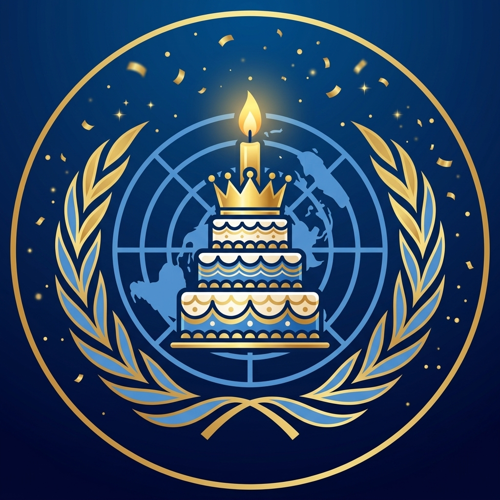

# 🎂 Tema: Aniversário do Servidor (`aniversario`)

Tema especial da **Gala de Aniversário da ONU (31 de Março — fundado em 31/03/2019)**. Utiliza molduras reais duplas (`👑 ═══ ... ═══ 👑`), separadores de coluna dupla (`║`) e paleta de ouro real, azul ONU de gala e rubi festivo.

- **Arquivo de Automação**: [`theme.json`](./theme.json)
- **Logo Oficial de Aniversário**: [`./assets/icon.png`](./assets/icon.png)
- **Ciclo de Duração (3 Semanas)**: `17/03` a `06/04` (1 semana antes + semana do aniversário `31/03` + 1 semana depois → retorna ao normal ou transiciona para a Páscoa).

<p align="left">
  
</p>

---

## 🏛️ Identidade do Servidor

| Propriedade | Base ONU | Tema Aniversário |
| :--- | :--- | :--- |
| **Nome do Servidor** | `Organização das Nações Unidas` | `Organização das Nações em Gala 🎂` |
| **Moldura de Categoria** | `▬▬▬▬▬▬  Nome  ▬▬▬▬▬▬` | `👑 ═══ Nome ═══ 👑` |
| **Separador de Canal** | `│` | `║` |
| **Separador de Cargos** | `-----------------` | `═══ 🎂 ═══` |

---

## 📂 Estrutura de Categorias e Canais

```text
Organização das Nações em Gala 🎂
│
├── 📁 🎂 ═══ Salão Real da ONU ═══ 🎂 (794044198881198090)
│   ├── # 🎂║parabens-geral             (794044202803658752)
│   ├── # 🎺║hino-da-gala               (794044204488720415)
│   └── # 🎈║convidados-de-honra        (794044207596568628)
│
├── 📁 👑 ═══ Cúpula de Aniversário ═══ 👑 (794044199514406923)
│   ├── 🔊 👑║Palco do Aniversário      (794044207231926302)
│   ├── 🔊 🏛️║Corte Histórica da ONU    (794044205231112232)
│   ├── 🔊 🎙️║Discurso de Fundação      (794044203771363328)
│   ├── 🔊🔒 🍰║Hora do Bolo            (812400426108452865)
│   └── 🔊🔒 🎁║Coma de Brigadeiro AFK  (794044208855777322)
│
└── 📁 🥂 ═══ Conselho Fundador ADM ═══ 🥂 (794044200756051989)
    ├── #🔒 👑║cupula-fundadora-adm     (794044213368848396)
    ├── #🔒 📸║capsula-de-memes         (794044205848723468)
    └── 🔊🔒 🥂║Salão VIP dos Ademar    (794044216933089320)
```

---

## 🛡️ Hierarquia Principal de Cargos (Paleta de Gala)

| Escalão | Role ID | Nome Original | Nome no Aniversário | Cor Hex | Estilo da Cor |
| :--- | :--- | :--- | :--- | :---: | :--- |
| **Tier 1** | `794044179029819392` | `Secretariado` | `👑 Fundadores Supremos` | `#FFD700` | 🟡 Ouro Real |
| **Tier 2** | `845826535810269225` | `Corte Jurídica` | `🎂 Guardiões da Coroa` | `#3B82F6` | 🔵 Azul Gala ONU |
| **Tier 3** | `794044189042147340` | `Corpo Diplomático` | `🥂 Embaixadores de Gala` | `#F43F5E` | 🔴 Rubi Festivo |
| **Tier 4** | `794044191951945778` | `Assembleia Geral` | `🎈 Convidados da Assembleia` | `#38BDF8` | 🩵 Azul Celeste ONU |
| **Separadores (x4)** | `900181759507968031` etc. | `-----------------` | `═══ 🎂 ═══` | `None` | Bolos divisores |
