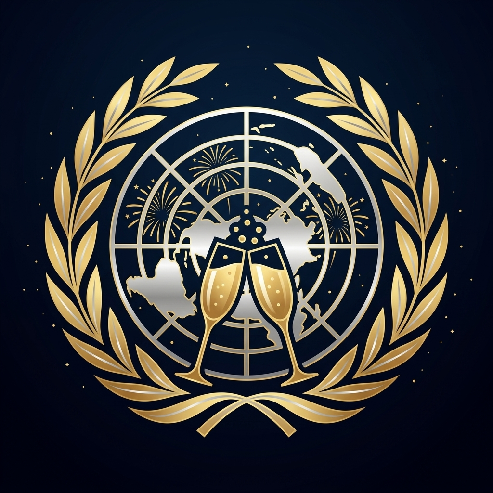

# 🎆 Tema: Ano Novo (`ano-novo`)

Tema especial de **Réveillon / Ano Novo (Fim de Dezembro / Janeiro)** para a ONU. Utiliza traços contínuos luminosos (`✨ ━━━ ... ━━━ ✨`), separador duplo tracejado (`╏`) e paleta de ouro champagne, âmbar e prata.

- **Arquivo de Automação**: [`theme.json`](./theme.json)
- **Logo Oficial de Ano Novo**: [`./assets/icon.png`](./assets/icon.png)
- **Ciclo de Duração (3 Semanas)**: `29/12` a `18/01` (Pré-Réveillon pós-Natal + semana da Virada `01/01` + 1 semana depois → retorna para `base-onu` em `19/01`).

<p align="left">
  
</p>

---

## 🏛️ Identidade do Servidor

| Propriedade | Base ONU | Tema Ano Novo |
| :--- | :--- | :--- |
| **Nome do Servidor** | `Organização das Nações Unidas` | `Organização das Nações Renovadas 🎆` |
| **Moldura de Categoria** | `▬▬▬▬▬▬  Nome  ▬▬▬▬▬▬` | `✨ ━━━ Nome ━━━ ✨` |
| **Separador de Canal** | `│` | `╏` |
| **Separador de Cargos** | `-----------------` | `━━━ ✨ ━━━` |

---

## 📂 Estrutura de Categorias e Canais

```text
Organização das Nações Renovadas 🎆
│
├── 📁 ✨ ━━━ Réveillon Geral ━━━ ✨ (794044198881198090)
│   ├── # 🥂╏brinde-geral              (794044202803658752)
│   ├── # 🎶╏playlist-da-virada        (794044204488720415)
│   └── # 🎇╏novos-ciclos              (794044207596568628)
│
├── 📁 🎆 ━━━ Cúpula da Virada ━━━ 🎆 (794044199514406923)
│   ├── 🔊 🎆╏Praia de Copacabana       (794044207231926302)
│   ├── 🔊 ⚖️╏Retrospectiva do Ano      (794044205231112232)
│   ├── 🔊 ⏳╏Contagem Regressiva       (794044203771363328)
│   ├── 🔊🔒 🍾╏After da Virada         (812400426108452865)
│   └── 🔊🔒 🥴╏Ressaca AFK             (794044208855777322)
│
└── 📁 🥂 ━━━ Camarote ADM ━━━ 🥂 (794044200756051989)
    ├── #🔒 🍾╏vip-adm                  (794044213368848396)
    ├── #🔒 📉╏retrospectiva-de-memes   (794044205848723468)
    └── 🔊🔒 🥂╏Camarote dos Ademar     (794044216933089320)
```

---

## 🛡️ Hierarquia Principal de Cargos (Paleta de Réveillon)

| Escalão | Role ID | Nome Original | Nome no Ano Novo | Cor Hex | Estilo da Cor |
| :--- | :--- | :--- | :--- | :---: | :--- |
| **Tier 1** | `794044179029819392` | `Secretariado` | `🎆 Soberanos do Novo Ciclo` | `#FFD700` | 🟡 Ouro Champagne |
| **Tier 2** | `845826535810269225` | `Corte Jurídica` | `🥂 Guardiões do Tempo` | `#F4A261` | 🟠 Âmbar Solar |
| **Tier 3** | `794044189042147340` | `Corpo Diplomático` | `✨ Embaixadores da Virada` | `#90E0EF` | 🔵 Azul Celeste Cristal |
| **Tier 4** | `794044191951945778` | `Assembleia Geral` | `🎇 Cidadãos do Novo Ano` | `#E0FBFC` | ⚪ Branco Réveillon |
| **Separadores (x4)** | `900181759507968031` etc. | `-----------------` | `━━━ ✨ ━━━` | `None` | Estrelas douradas divisoras |
