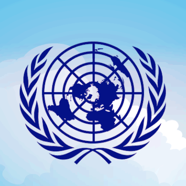
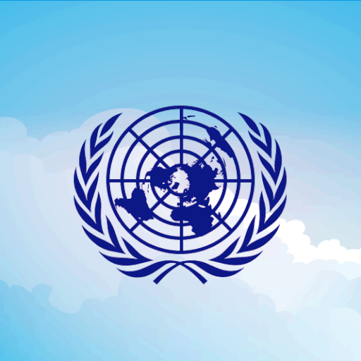

# 🌐 Tema: Base Oficial (`base-onu`)

Este é o **tema padrão oficial** da **Organização das Nações Unidas (ONU)**. Serve como ponto de restauração sempre que um evento sazonal (Halloween, Natal, Ano Novo, Páscoa) se encerra.

- **Arquivo de Automação**: [`theme.json`](./theme.json)
- **Logo Estática Oficial**: [`./assets/icon.png`](./assets/icon.png)
- **Logo Animada (GIF)**: [`./assets/icon.gif`](./assets/icon.gif)
- **Preview de Referência**: [`../../img/onu-base.png`](../../img/onu-base.png)

<p align="left">
  
  
</p>

---

## 🏛️ Identidade do Servidor

| Propriedade | Valor |
| :--- | :--- |
| **Nome do Servidor** | `Organização das Nações Unidas` |
| **Moldura de Categoria** | `▬▬▬▬▬▬  Nome  ▬▬▬▬▬▬` |
| **Separador de Canal** | `│` |
| **Separador de Cargos** | `-----------------` |

---

## 📂 Estrutura de Categorias e Canais

```text
Organização das Nações Unidas
│
├── 📁 ▬▬▬▬▬▬  Geral  ▬▬▬▬▬▬ (794044198881198090)
│   ├── # 🌍│geral-do-geral       (794044202803658752)
│   ├── # 🎵│musiquinha           (794044204488720415)
│   └── # 👋│salve-salve          (794044207596568628)
│
├── 📁 ▬▬▬▬▬ Assembleia  ▬▬▬▬▬ (794044199514406923)
│   ├── 🔊 🛰️│Central de Voz      (794044207231926302)
│   ├── 🔊 🏛️│Supremo Tribunal    (794044205231112232)
│   ├── 🔊 🎙️│Palanque Central    (794044203771363328)
│   ├── 🔊🔒 🎉│Salão da Festa    (812400426108452865)
│   └── 🔊🔒 💤│AFK               (794044208855777322)
│
└── 📁 ▬▬▬▬▬ ADM ▬▬▬▬▬ (794044200756051989)
    ├── #🔒 🤙adm-chat             (794044213368848396)
    ├── #🔒 📉│chat-falido-de-memes (794044205848723468)
    └── 🔊🔒 Call Dos Ademar       (794044216933089320)
```

---

## 🛡️ Hierarquia Principal de Cargos (Paleta Diplomática Oficial)

> [!NOTE]
> Apenas os 4 cargos da Hierarquia Principal e os 4 separadores visuais são alterados pelos temas. Todos os demais cargos customizados/zoeira permanecem intocados.

| Escalão | Role ID | Nome na Base | Cor Hex | Significado da Cor |
| :--- | :--- | :--- | :---: | :--- |
| **Tier 1 (Topo)** | `794044179029819392` | `Secretariado` | `#5B92E5` | 🔵 Azul Oficial da Bandeira da ONU |
| **Tier 2** | `845826535810269225` | `Corte Jurídica` | `#F1C40F` | 🟡 Dourado Soberano da Justiça |
| **Tier 3** | `794044189042147340` | `Corpo Diplomático` | `#95A5A6` | ⚪ Prata Diplomático |
| **Tier 4 (Base)** | `794044191951945778` | `Assembleia Geral` | `#1ABC9C` | 🟢 Turquesa Assembleia |
| **Separadores (x4)** | `900181759507968031`, `845826404380835841`, `854712377982976010`, `794044188408283217` | `-----------------` | `None` | Traço clássico padrão |
