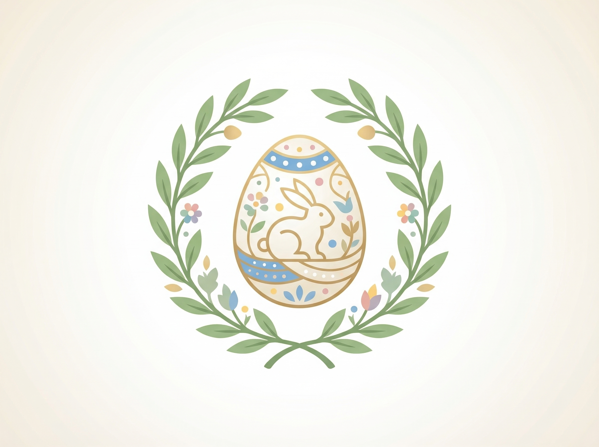

# 🐰 Tema: Páscoa (`pascoa`)

Tema especial de **Páscoa (Março / Abril)** para a ONU, baseado exatamente na estrutura de referência do canal `#eventos-pascoa` e com a logo oficial de Páscoa da ONU.

- **Arquivo de Automação**: [`theme.json`](./theme.json)
- **Logo Oficial de Páscoa**: [`./assets/icon.png`](./assets/icon.png)
- **Ciclo de Duração (3 Semanas)**: `07/04` a `27/04` (1 semana antes + semana da Páscoa + 1 semana depois → retorna para `base-onu` em `28/04`).

<p align="left">
  
</p>

---

## 🏛️ Identidade do Servidor

| Propriedade | Base ONU | Tema Páscoa |
| :--- | :--- | :--- |
| **Nome do Servidor** | `Organização das Nações Unidas` | `Organização das Nações da Páscoa 🐰` |
| **Moldura de Categoria** | `▬▬▬▬▬▬  Nome  ▬▬▬▬▬▬` | `🌸 ─── Nome ─── 🌸` |
| **Separador de Canal** | `│` | `┆` |
| **Separador de Cargos** | `-----------------` | `─── 🥚 ───` |

---

## 📂 Estrutura de Categorias e Canais

```text
Organização das Nações da Páscoa 🐰
│
├── 📁 🌸 ─── Grande Conselho da Páscoa ─── 🌸 (794044198881198090)
│   ├── # 🌍┆chat-geral-da-paz                 (794044202803658752)
│   ├── # 🎵┆sinfonia-da-páscoa                (794044204488720415)
│   └── # 👋┆boas-vindas-da-renovação          (794044207596568628)
│
├── 📁 🥚 ─── Plenário de Primavera ─── 🥚 (794044199514406923)
│   ├── 🔊 🗳️┆Plenário da Primavera            (794044207231926302)
│   ├── 🔊 ⚖️┆Tribunal do Coelho               (794044205231112232)
│   ├── 🔊 🕊️┆Mesa Redonda dos Ovos            (794044203771363328)
│   ├── 🔊🔒 🎉┆Salão de Festa dos Ovos         (812400426108452865)
│   └── 🔊🔒 💤┆Túmulo dos Inativos da Páscoa   (794044208855777322)
│
└── 📁 🍫 ─── Alto Comando do Cacau ─── 🍫 (794044200756051989)
    ├── #🔒 🔒┆arquivos-secretos-do-conselho    (794044213368848396)
    ├── #🔒 📉┆memes-chocos                     (794044205848723468)
    └── 🔊🔒 👑┆Cúpula dos Coelhos Supremos     (794044216933089320)
```

---

## 🛡️ Hierarquia Principal de Cargos (Paleta de Páscoa)

| Escalão | Role ID | Nome Original | Nome na Páscoa | Cor Hex | Estilo da Cor |
| :--- | :--- | :--- | :--- | :---: | :--- |
| **Tier 1** | `794044179029819392` | `Secretariado` | `🍫 Alto Comando do Cacau` | `#A0522D` | 🟤 Chocolate Real |
| **Tier 2** | `845826535810269225` | `Corte Jurídica` | `⚖️ Tribunal do Coelho` | `#FFD166` | 🟡 Ouro Creme |
| **Tier 3** | `794044189042147340` | `Corpo Diplomático` | `🕊️ Embaixadores da Primavera` | `#FF85A1` | 🌸 Rosa Pastel |
| **Tier 4** | `794044191951945778` | `Assembleia Geral` | `🥚 Plenário da Páscoa` | `#80ED99` | 🟢 Verde Menta Pastel |
| **Separadores (x4)** | `900181759507968031` etc. | `-----------------` | `─── 🥚 ───` | `None` | Ovos de Páscoa divisores |
